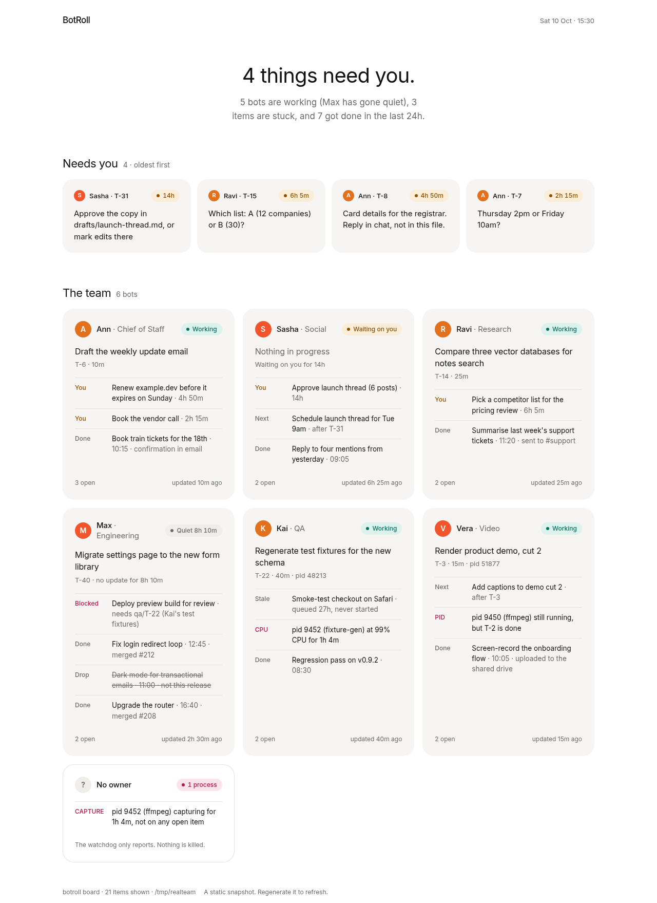
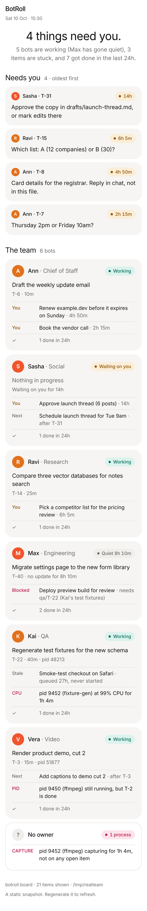
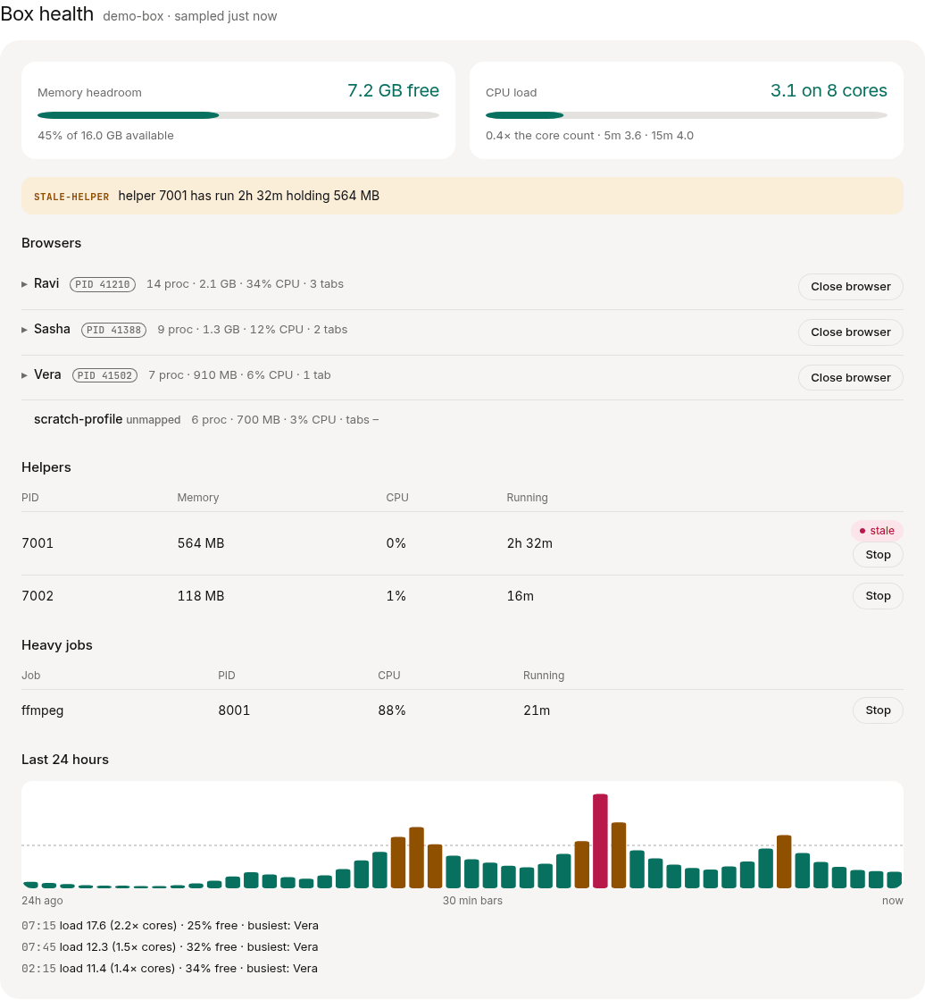

# BotRoll

[](https://github.com/saadkamal/botroll/actions/workflows/ci.yml)
[](LICENSE)


**The roll call for your bots: one plain-text file per bot, and a board that tells you what's waiting on you, who's working, what's stuck and what got done.**

[Website](https://botroll.co) · [Quickstart](#quickstart) · [Self-host on Railway](#on-railway) · [Box health](#box-health-optional) · [Security](#security) · [FAQ](#faq)

An agent-first task list. Every bot records what it's doing, what's done, and what it's waiting on you for, in plain files you can read and edit. One command shows you the whole team.



If you run several AI assistants, each one's commitments live only in its chat, and things fall through:

- A three-part ask where one part blocked and the other two silently never started.
- A question to you that got buried for a day.
- A screen recording left running all night, or a hung ffmpeg at 100% CPU for a day.
- "Is anyone working right now?" with no way to tell.

BotRoll fixes this with as little as possible: a markdown file per bot, a CLI the bots call, a watchdog that reports (and never kills), and a board that answers four questions at a glance, on a phone: what's waiting on me, who's working, what's stuck, and what got done today.

It is a small Python package with no dependencies. It needs no server or account. If you want the board on your phone from anywhere, `botroll serve` hosts it behind a password (see [Self-host](#self-host)).

## Features

- **Plain files.** One markdown file per bot, one line per item. Bots and people edit them with any tool; `git diff` shows what changed.
- **A CLI the bots call.** `botroll add`, `set`, `note`, `done`, `list`, with locked atomic writes, plus an [agent skill](skill/SKILL.md) that teaches the rules.
- **A board for humans.** Terminal, static HTML or JSON, built for a phone: a one-sentence summary, a "Needs you" strip, and a card per bot.
- **A watchdog that never kills.** It reports stale items, forgotten PIDs, CPU hogs and stray screen recordings.
- **Self-hosting.** `botroll serve` puts the live board behind one password, with signed cookies, CSRF protection and rate-limited sign-in. Dockerfile and `railway.toml` included.
- **Optional extras, off by default.** Email (Resend, Cloudflare, SMTP), signed Approve / Decline / Reply / Nudge actions to your bots' webhooks, a Sync now button, and [Box health](#box-health-optional) for shared machines.
- **No dependencies.** Python 3.10+ standard library only, on Linux and macOS.

## Quickstart

```sh
pipx install git+https://github.com/saadkamal/botroll   # or: uv tool install git+https://github.com/saadkamal/botroll
export BOTROLL_DIR=~/botroll   # where the task files live (default ~/.botroll)
export BOTROLL_HUMAN=sam       # optional: waiting-human is written as waiting-sam
```

Give each bot the rules in [`skill/SKILL.md`](skill/SKILL.md). It is an [agent skill](https://agentskills.io); if your bot doesn't read skills, paste the part below the front matter into its `AGENTS.md` or system prompt. Then a bot's turn looks like this:

```sh
$ botroll add social "Draft the launch thread"
social/T-1
$ botroll add social "Schedule it for Tuesday" --state todo
social/T-2
$ botroll set social T-1 waiting-human --note "Approve the copy in drafts/thread.md?"
social/T-1 [waiting-sam]
```

And you look at the board:

```sh
botroll board                       # in the terminal
botroll board --html board.html     # a static page for your phone
botroll board --json                # everything, for scripts
```

To try it on the example team, run `BOTROLL_NOW="2026-10-10 15:30" botroll --dir examples/tasks board`.

## The file format

One file per bot, `<bot>.md`, with one line per item. A multi-part ask is one line per part. The file name is the bot's slug, which commands and ids use. Optional front matter gives the bot a name and a role, which the board and `botroll list` show as "Sasha · Social".

```
---
name: Sasha
role: Social
---

- [waiting-human] T-31 Approve launch thread · asked 2026-10-09 23:40 · updated 2026-10-10 01:10 · note: Approve the copy in drafts/launch-thread.md?
- [doing] T-32 Render the header image · asked 2026-10-10 14:40 · updated 2026-10-10 15:15 · pid: 51877
```

- The state in brackets is one of `todo`, `doing`, `waiting-human`, `blocked`, `done` or `dropped`. Any `waiting-…` word counts as `waiting-human`.
- `T-<n>` ids count up per file. Refer to an item from elsewhere as `<bot>/T-<n>`.
- After the title come ` · `-separated fields: `asked <time>`, `updated <time>`, then `key: value` pairs. `note:` says what's needed, what's blocking, or where the result went. `pid:` holds the PIDs of background processes started for the item. Any other key is kept.
- Times are local, `YYYY-MM-DD HH:MM`.
- `name:` and `role:` in the front matter are optional. Without a name the board uses the slug, and without a role it shows the name alone. `botroll add` starts a new file with `name:` set to the slug and an empty `role:` for you to fill in.
- Anything else that isn't an item line, such as prose, comments or other bullets, is kept as written.

Hand edits are fine. The parser accepts loose spacing and any case, and a CLI write rewrites only the line it changes. A hand edit can race with a CLI write, so bots should use the CLI.

## Commands

```
botroll add   <bot> <title...> [--state S] [--note TEXT] [--pid N]   prints the new id (state defaults to doing)
botroll set   <bot> <id> <state> [--note TEXT] [--pid N]
botroll note  <bot> <id> <text...>
botroll done  <bot> <id> [--note TEXT] [--pid N]
botroll list  [bot...] [--all]          open items under each bot's name and role, with ! on stale ones
botroll watch                           the watchdog; exits 1 if anything is flagged
botroll board [--html FILE | --json]    the human view
botroll serve [--port N] [--data DIR]   the live board behind a password, and the push API (see Self-host)
botroll push  [--url URL] [--token T] [--prune [--yes | --dry-run]]   upload every roll file and the watchdog's process flags to a server
botroll health [--every 60] [--config F] sample the machine: memory, load, browsers, helpers, heavy jobs (see Box health)
botroll hash-password                   read a password, print a hash for BOTROLL_PASSWORD_HASH
botroll email test                      send a test email with the server's email settings (see Email)
```

Every command takes `--dir`. Every write takes a lock on the directory, re-reads the file, and replaces it atomically, so bots can write at the same time. Each change sets `updated`.

The same operations are a Python library: `botroll.add`, `botroll.update`, `botroll.read` and `botroll.board.snapshot`.

## The board

The summary sentence counts **open** work and what **got done in the last 24 hours** (rolling), not the calendar day — so a midnight timezone flip does not empty the board. Times in task files and on the board use `BOTROLL_TZ` (or the server's local zone); an unknown zone name logs a warning and falls back to UTC. Done items stamped up to 10 minutes in the future (bot clock drift) still count. Set the same zone on the server and on the bots' machine.


The board puts one sentence on top ("4 things need you. 5 bots are working (Max has gone quiet), 3 items are stuck, and 6 got done today."). Below it is what's waiting on you, oldest first ("Ann · T-8"), then a card per bot, titled with its name and role ("Ann · Chief of Staff"), showing what it's doing now, its asks, and anything stuck. An outlined "No owner" card holds runaway processes that no item claims. On a phone, each card's done items collapse to one line.



The page is one self-contained HTML file. It makes no network requests, follows your light or dark setting, and reloads itself every minute. To keep it current, regenerate it on a schedule and put it somewhere your phone can reach, such as a synced folder or a static file server on your tailnet:

```cron
* * * * * BOTROLL_DIR=$HOME/botroll botroll board --html $HOME/Sync/board.html >/dev/null
```

## Self-host

`botroll serve` puts the live board on the web for you alone. Your bots keep writing files on their own machine, and `botroll push` uploads them to the server, which stores them and renders the board fresh on every visit. The server never runs your bots and never looks at its own processes. The watchdog's process flags (pid, cpu, capture) come from the bots' machine with each push.


There is one password, at least 12 characters with 5 different ones, and it must be different from the push token and from `BOTROLL_SECRET`. Sign-in sets a signed cookie for 12 hours, or 30 days with "Keep me signed in". Sign out revokes every session, including a cookie someone copied. Changing the password (or `BOTROLL_PASSWORD_HASH`) does the same. Failed sign-ins are limited to 5 per IP address per 15 minutes. Every page is uncached and unindexed, can't be framed, and runs no script but the board's own. The server refuses to start without a password and a secret. Pushes use a separate token, so a leaked push token can change what the board says but can't sign anyone in.

The board shows when the last push arrived ("Pushed 3m ago"), and warns you when nothing has arrived for 30 minutes.

Served pages follow your device's light or dark setting. The System / Light / Dark switch in the header overrides it. Your choice is kept in a cookie and the server renders it, so the page never flashes the wrong theme, and the switch works without JavaScript.

### On Railway

**One click:** once a Railway template is published for this repo, a "Deploy on Railway" button goes here. Until then, use the CLI steps below (about five minutes).

You need the [Railway CLI](https://docs.railway.com/guides/cli) and a checkout of this repository. `botroll hash-password` needs BotRoll installed locally (see [Quickstart](#quickstart)), not just the checkout.

Set the volume and the variables first, then deploy. A first `railway up` with nothing set fails, and changing variables later triggers a redeploy.

```sh
botroll hash-password                       # type a password of 12+ characters; copy the scrypt$… line
railway init                                # a new project
railway service                             # link this directory to a service, if init didn't
railway volume add --mount-path /data       # roll files live here and survive redeploys
railway variables \
  --set 'BOTROLL_PASSWORD_HASH=scrypt$…' \
  --set "BOTROLL_SECRET=$(python3 -c 'import secrets; print(secrets.token_urlsafe(32))')" \
  --set "BOTROLL_PUSH_TOKEN=$(python3 -c 'import secrets; print(secrets.token_urlsafe(32))')" \
  --set BOTROLL_CLIENT_IP_HEADER=X-Real-IP  # Railway sets this; without it, rate-limits use the proxy hop
  --set BOTROLL_TZ=Europe/London            # your timezone, so ages on the board are right
railway up                                  # builds the Dockerfile
railway domain                              # a public https address
```

Railway sets `PORT` and terminates https. `railway.toml` points its health check at `/health`, the only page that needs no sign-in. Read the push token back with `railway variables` when you set up the bots' machine.

Railway Free, Trial and Hobby block outbound SMTP. Use Resend or Cloudflare's email API on those plans, not `smtp` and not Cloudflare's SMTP endpoint. `railway run botroll email test` runs on your machine, so it can succeed even when the deployed service cannot send.

### On any host

Anything that runs a container or Python 3.10+ works. Copy [`botroll.env.example`](botroll.env.example) to `botroll.env` and fill it in. Keep `botroll.env` out of the Docker build folder (`*.env` is in `.dockerignore`, but a secret sitting next to `docker build .` is still easy to bake in by mistake). Then:

```sh
docker build -t botroll .
docker run -d -p 8000:8000 -v botroll-data:/data --env-file botroll.env botroll
```

The image's command is already `botroll serve --behind-proxy`. Extra arguments go after the image name, replacing that command:

```sh
docker run -d -p 8000:8000 -v botroll-data:/data --env-file botroll.env botroll \
  botroll serve --insecure-http
```

Without Docker, install BotRoll and run `BOTROLL_DATA=/var/lib/botroll botroll serve --behind-proxy` under systemd or similar. Either way, put it behind a proxy that terminates https (Caddy, nginx, a tunnel), because the session cookie is only sent over https. On a plain-http LAN address the Secure cookie is never stored, so sign-in loops with no error. Pass `--insecure-http` for that case (and only that case): it drops Secure and prints a warning that anyone on the network can steal the session.

`--behind-proxy` takes the scheme from `X-Forwarded-Proto` for HSTS. The client address for rate-limiting stays the socket peer unless you opt in with `--client-ip-header` or `BOTROLL_CLIENT_IP_HEADER` (on Railway, `X-Real-IP`). The Docker image sets `--behind-proxy` and does **not** trust a client-IP header until you set one. Only opt in when a trusted edge overwrites that header: on private networking, a TCP proxy, or a directly exposed port, clients can send `X-Real-IP` themselves and rotate it to dodge the rate-limit bucket.

Caddy (overwrites the header; do not pass the client's value through):

```
reverse_proxy localhost:8000 {
    header_up X-Real-IP {remote_host}
    header_up X-Forwarded-Proto {scheme}
}
```

nginx:

```
proxy_set_header X-Real-IP $remote_addr;
proxy_set_header X-Forwarded-Proto $scheme;
```

Then run `botroll serve --behind-proxy --client-ip-header X-Real-IP`, or set `BOTROLL_CLIENT_IP_HEADER=X-Real-IP`.

Container logs are stamped by Docker/Railway in UTC unless you set `TZ` on the container. Board ages and the digest hour still use `BOTROLL_TZ`.

To try it on your own machine without a password, run `botroll serve --insecure-local`. It listens on 127.0.0.1 and answers only to `localhost`.

### Pushing from the bots' machine

Push every minute from cron:

```cron
* * * * * BOTROLL_DIR=$HOME/botroll BOTROLL_PUSH_URL=https://botroll.example.com BOTROLL_PUSH_TOKEN=… botroll push >/dev/null
```

`BOTROLL_URL` still works as the push target, so existing cron lines keep working. Prefer `BOTROLL_PUSH_URL` so it isn't confused with the server's `BOTROLL_URL`, which is the board address emails link to.

Each push uploads every roll file whole, then the watchdog's current process flags, replacing the last ones. A roll file over 256 KiB is skipped with a warning; the others still go, and `botroll push` exits 1 if anything was skipped. It refuses to send the token over plain http to anything but localhost.

A dropped connection is retried, so one flaky network hop doesn't fail the whole push. A drop before the request went out (refused, or cut during the TLS handshake) is retried on every call. A drop after it was sent, with no reply, is retried only for the roll files and the watchdog flags, which just replace what's there; it is never retried for `POST /api/prune` or the Box health sample, since the server may already have acted on it. A reply, even an error, is never retried. `BOTROLL_RETRIES` sets how many retries (default 3, `0` turns them off) and `BOTROLL_RETRY_BACKOFF` the first wait in seconds (default 1, doubling each time, at most 30). Negative values count as 0; a value that isn't a number (or, for retries, a whole number) prints a warning and uses the default.

A bot's file stays on the server after you delete or rename it locally. `botroll push --prune` also calls `POST /api/prune` (same push token) with the slugs it just pushed and prints the roll files the server *would* delete: it's a dry run. `botroll push --prune --yes` sends `"confirm": true` and the server deletes them, within limits kept in `.prune.json` in the data directory: at most 3 deletions an hour across all calls, never below half the bots there were at the start of the hour, never more than half the bots in one call, and never the last bot. The budget is saved before anything is deleted. If `.prune.json` is missing, unreadable or dated in the future, or the clock has gone backwards, the server fails closed: it starts a fresh hour with the budget already used up, so the first confirmed prune on a new server waits an hour. Over a limit it answers 409 and deletes nothing, so a wrong keep list can't wipe the board. It also refuses an empty list.

For a scheduled push, `botroll push --prune --dry-run` never deletes, and when anything *would* be removed it prints a warning to stderr and exits with status `3` (otherwise as usual: `0`, or `1` if a roll file was skipped). A cron job or a systemd timer then shows you a bot that went missing before anything is gone. `--dry-run` needs `--prune` and can't go with `--yes`. Plain `--prune` is unchanged.

There is one push token for all bots. A per-bot token, limited to that bot's `/api/roll/<slug>`, is not supported yet: `botroll push` sends every roll file from one machine with one token, and `/api/prune` and `/api/watch` work across bots, so a per-bot token would only help bots that push on their own.

A bot whose file you delete locally stays on the board until you delete its file from the server's volume. On Railway:

```sh
railway ssh
rm /data/<bot>.md
```

On Docker, the same path is on the `botroll-data` volume.

### Server settings

| Variable | |
| --- | --- |
| `BOTROLL_PASSWORD_HASH` | the output of `botroll hash-password` (needs BotRoll installed). Required, unless you set `BOTROLL_PASSWORD` instead. The password must be at least 12 characters with 5 different ones |
| `BOTROLL_PASSWORD` | the password itself, hashed at startup. Simpler, but the plain password then sits in the host's settings |
| `BOTROLL_SECRET` | at least 32 random characters, for signing cookies. Required. Changing it, changing the password, or signing out revokes every session |
| `BOTROLL_PUSH_TOKEN` | at least 32 random characters, different from the password and from `BOTROLL_SECRET`. Without it the push API is off |
| `BOTROLL_DATA` | where pushed files are stored. `/data` in the container; otherwise `--dir` |
| `PORT` | the port to listen on, default 8000 |
| `BOTROLL_TZ` | your timezone, such as `America/New_York`. Ages on the board, and the digest hour, are measured in it. Without it, the machine's zone (`TZ`) |
| `BOTROLL_URL` | on the server: the board's https address, linked from emails. On the bots' machine: an alias for `BOTROLL_PUSH_URL` |
| `BOTROLL_PUSH_URL` | where `botroll push` sends files. Prefer this over `BOTROLL_URL` on the bots' machine |
| `BOTROLL_CLIENT_IP_HEADER` | client-address header to trust when `--behind-proxy` is set. Default: none (the socket peer). Set `X-Real-IP` on Railway, or when Caddy/nginx overwrite that header |
| `BOTROLL_HOST_COOKIES` | `1`/`true`/`yes`/`on` to name the cookies `__Host-botroll_session` and so on. Browsers then refuse to let a sibling subdomain or a plain-http page set or shadow them. Off by default. Needs https (not with `--insecure-http` or `--insecure-local`), and turning it on signs everyone out once |
| `BOTROLL_ACTIONS` | path to an actions file (default `$BOTROLL_DATA/actions.json`). Missing file: the feature is off |
| `BOTROLL_ACTION_<SLUG>_URL` | per-bot action URL, slug in `SCREAMING_SNAKE` (`assistant` → `ASSISTANT`, `my-bot` → `MY_BOT`) |
| `BOTROLL_ACTION_<SLUG>_SECRET` | HMAC secret for that bot. Required unless `_HEADER` is set |
| `BOTROLL_ACTION_<SLUG>_HEADER` | static header the receiver already knows, `Name: value` (for example `Authorization: Bearer …`) |
| `BOTROLL_SYNC_URL`, `_SECRET`, `_HEADER` | optional board-level endpoint for the **Sync now** button (see [Sync now](#sync-now-optional)) |
| `BOTROLL_ACTIONS_ALLOW_HTTP` | `1`/`true`/`yes`/`on` to allow `http://` action URLs (otherwise https only) |
| `BOTROLL_ACTIONS_ALLOW_PRIVATE` | same values: allow loopback / private / link-local / CGNAT action URLs |
| `BOTROLL_ACTIONS_ALLOW_PORTS` | same values: allow ports other than 443/80 (8080/8443 also allowed when `allow_http` is on) |

Email has its own settings, below. Action URLs are documented under [Actions (optional)](#actions-optional).

### Email

Email is off unless you set `BOTROLL_EMAIL_PROVIDER`. Then the server sends two kinds:

- **Needs you**, when a bot starts waiting on you. It waits for a minute with no new asks, so a burst becomes one email, and sends at most one every 15 minutes, listing everything new since the last. If asks keep arriving, it still sends within about 5 minutes of the oldest waiting one. An ask answered before the email goes out is left out, and one that's answered and later asked again counts as new.
- **A daily digest**, if you set `BOTROLL_DIGEST_HOUR`: what got done today, what's stuck, which bots went quiet, and the watchdog's findings. On a day with none of those, it isn't sent.

What was sent is kept in `.notify.json` in the data directory, so a restart or redeploy doesn't send it again. When you first turn email on, everything already waiting counts as new and arrives in one email.

Bot text is untrusted, because anyone who can write a bot's file can write it. Subjects never contain it. In the body it is escaped, invisible and direction-changing characters are removed, and links and domains are defanged: `https://x.example/login` arrives as `https[://]x[.]example/login`, so no mail client makes it clickable. The cost is that a file name like `notes.md` reads `notes[.]md`. The one link in each email is "Open the board", to the server's `BOTROLL_URL` (the public board address, not the push target).

A failed send is retried twice within seconds, then after 2, 4 and 8 minutes and so on, up to an hour apart, with each failure in the server's log. It never stops the board.

To check your settings, run `botroll email test` with the server's variables from a machine that has BotRoll installed. On Railway, `railway run botroll email test` uses those variables but sends from your machine, so a local success does not prove the deployed service can send. On Hobby, use Resend or the Cloudflare API.

| Variable | |
| --- | --- |
| `BOTROLL_EMAIL_PROVIDER` | `resend`, `cloudflare` or `smtp` |
| `BOTROLL_EMAIL_FROM` | the sender, such as `bots@yourdomain.com` or `BotRoll <bots@yourdomain.com>`, on a domain your provider has verified |
| `BOTROLL_EMAIL_TO` | one or more addresses, comma-separated |
| `BOTROLL_DIGEST_HOUR` | 0 to 23, in `BOTROLL_TZ`. Without it there's no digest |

**Resend.** Add and verify your domain under [Domains](https://resend.com/domains), and create an API key with sending access under [API keys](https://resend.com/api-keys). Then set:

```sh
BOTROLL_EMAIL_PROVIDER=resend
RESEND_API_KEY=re_…
```

**Cloudflare Email Sending.** Onboard your domain to [Email Sending](https://developers.cloudflare.com/email-service/) in the dashboard, or with `npx wrangler email sending enable yourdomain.com`. Create an API token that is allowed to send email for the account. BotRoll calls the REST API, `POST /accounts/{CF_ACCOUNT_ID}/email/sending/send`. Then set:

```sh
BOTROLL_EMAIL_PROVIDER=cloudflare
CF_ACCOUNT_ID=…        # on the account's overview page
CF_EMAIL_TOKEN=…
```

**SMTP.** This works with any mail service that offers SMTP, such as Fastmail, Postmark, Amazon SES, Gmail with an app password, or your own server. Set:

```sh
BOTROLL_EMAIL_PROVIDER=smtp
SMTP_HOST=smtp.example.com
SMTP_PORT=587          # default: 587 for starttls, 465 for ssl
SMTP_USER=…            # optional; set both or neither
SMTP_PASS=…
SMTP_TLS=starttls      # starttls (default) or ssl; off is allowed only to localhost
```

Cloudflare's SMTP endpoint works too: `SMTP_HOST=smtp.mx.cloudflare.net`, `SMTP_TLS=ssl`, `SMTP_USER=api_token`, and `SMTP_PASS` set to the token.

## Actions (optional)

A way to act on an item from the live board and wake the bot. Off unless you point at least one bot at a URL. The static `botroll board --html` page never shows buttons. With no file and no `BOTROLL_ACTION_*` variables, the served board is unchanged.

Put `actions.json` in the data directory (or set `BOTROLL_ACTIONS` to a path), mapping each bot slug to a URL and a secret and/or a static header:

```json
{
  "assistant": {
    "url": "https://hooks.example.com/botroll",
    "secret": "a-long-random-string-of-32-chars+"
  }
}
```

Or the same thing as env, which is easier on Railway:

```sh
BOTROLL_ACTION_ASSISTANT_URL=https://hooks.example.com/botroll
BOTROLL_ACTION_ASSISTANT_SECRET=a-long-random-string-of-32-chars+
# optional, instead of or as well as the secret:
# BOTROLL_ACTION_ASSISTANT_HEADER=Authorization: Bearer …
```

Bots with an endpoint get small pill buttons: **Approve**, **Decline** and **Reply…** on a waiting-on-you item, and **Nudge** on any open item. Reply opens a one-line note. The click is a POST to BotRoll (signed-in session and CSRF). BotRoll then POSTs JSON to the bot's URL. The board does **not** change the item; the bot does the work, updates its roll line, and the next `botroll push` refreshes the card. Until then the item may show "pending action".

The body is:

```json
{
  "event": "botroll.action",
  "action": "approve",
  "bot": "assistant",
  "item_id": "T-7",
  "item_title": "Book the vendor call",
  "state": "waiting-human",
  "note": "Thursday 2pm or Friday 10am?",
  "actor": "owner",
  "board_url": "https://botroll.example.com",
  "sent_at": 1760000000,
  "id": "2c1b0a4e-…"
}
```

`action` is `approve`, `decline`, `reply` or `nudge`. `note` is what you typed on Reply, otherwise the item's existing note. `id` is a UUID for that click. BotRoll records the id as pending **before** it POSTs, so a double-click, five concurrent identical clicks, or a restart mid-send is delivered once. **Receivers must also ignore a repeated payload `id`.** `board_url` is the server's `BOTROLL_URL`. Clicks are stored in `.actions.json` in the data directory, keyed by id. The same item can be clicked again after 10 seconds.

An HMAC `secret` is at least 32 characters. `BOTROLL_ACTIONS_ALLOW_HTTP`, `_PRIVATE` and `_PORTS` (and the matching JSON flags) accept only `1`/`true`/`yes`/`on` or `0`/`false`/`no`/`off`/empty. A misspelled `BOTROLL_ACTION_*` name refuses to start.

Ports: **443** always, **80** for http (needs `allow_http`). **8080** and **8443** need `allow_http` or `allow_ports` / `BOTROLL_ACTIONS_ALLOW_PORTS`. Any other port needs `allow_ports`.

### Signature

When `secret` is set, BotRoll sends `X-BotRoll-Signature: t=<unix>,v1=<hex>`: HMAC-SHA256 of `{t}.{raw body}` with the per-bot secret, Stripe-style. Receivers that only accept a key header can skip the secret and set `header` (`Authorization: Bearer …`, or any `Name: value`). You can send both.

Python:

```python
import hashlib, hmac, time

def verify(secret, body: bytes, header: str, max_age=300) -> bool:
    fields = dict(p.split("=", 1) for p in header.split(",") if "=" in p)
    ts, got = fields.get("t", ""), fields.get("v1", "")
    if not ts.isdigit() or abs(time.time() - int(ts)) > max_age:
        return False
    want = hmac.new(secret.encode(), f"{ts}.".encode() + body, hashlib.sha256).hexdigest()
    return hmac.compare_digest(got, want)
```

JavaScript:

```js
import { createHmac, timingSafeEqual } from "node:crypto";

function verify(secret, body, header, maxAge = 300) {
  const fields = Object.fromEntries(header.split(",").filter(p => p.includes("=")).map(p => p.split("=", 2)));
  const ts = fields.t, got = fields.v1 || "";
  if (!/^\d+$/.test(ts) || Math.abs(Date.now() / 1000 - Number(ts)) > maxAge) return false;
  const want = createHmac("sha256", secret).update(`${ts}.`).update(body).digest("hex");
  return got.length === want.length && timingSafeEqual(Buffer.from(got), Buffer.from(want));
}
```

Outbound POSTs are https only (set `BOTROLL_ACTIONS_ALLOW_HTTP` or `"allow_http": true` on that bot for http), do not follow redirects, and use a 10-second absolute deadline for the whole delivery. The connection is made to the IP that was validated (Host and TLS SNI stay the hostname), so a later DNS change cannot rebind the request. Addresses that are not global — including CGNAT `100.64/10` — are refused unless `BOTROLL_ACTIONS_ALLOW_PRIVATE` or `"allow_private": true`. The response body is ignored; 2xx is success.

### Recipes

**Generic webhook.** Any URL that accepts `POST` `application/json`. Verify the signature with the snippet above, or set `header` to a shared key if the receiver cannot check HMAC.

**Zapier / n8n.** Create a Catch Hook (Zapier) or Webhook trigger (n8n). Put that URL in `url`. Zapier and most n8n setups cannot verify HMAC: set `header` to a secret the scenario checks, or the key Zapier shows you. Then branch on `action`.

**Grok Bot routines.** In the routine panel, add a webhook trigger. It gives you a URL and a sender key, and names the header it expects (often `Authorization: Bearer <key>`). Put the URL in `url` and the header name and value in `header`. No `secret` needed unless you also verify HMAC in the routine. The routine should do the work, then update its roll (`botroll set` / `note` / `done`) so the next push clears "pending action".

### Sync now (optional)

A board-level **Sync now** button, for asking the bots' machine to push right away. Off unless you configure a board endpoint: the key `"*"` in `actions.json`, or env:

```sh
BOTROLL_SYNC_URL=https://hooks.example.com/botroll-sync
BOTROLL_SYNC_SECRET=a-long-random-string-of-32-chars+
# BOTROLL_SYNC_HEADER=Authorization: Bearer …
```

It uses the same delivery as item actions (HMAC `X-BotRoll-Signature`, optional static header, https-only and SSRF rules, 10-second deadline, claim-before-send dedupe on `id`, one click per 10 seconds). The payload is the usual `botroll.action` event with `"action": "sync"` and `bot`, `item_id`, `item_title` and `state` set to `null`. The receiver should run its push (for example `botroll push`); the board's "Pushed … ago" line then updates. The button shows "Sync sent ✓ HH:MM" or "Sync failed HH:MM" after the click. The status dims after 30 seconds and is gone on a reload after 10 minutes.

An empty `BOTROLL_SYNC_URL` turns the button off, and BotRoll logs that it did. An unknown `BOTROLL_SYNC_*` name logs a warning and is ignored. If both `"*"` and `BOTROLL_SYNC_URL` are set, BotRoll logs a warning and uses the env.

Copy [`actions.json.example`](actions.json.example) as a starting point.

## The watchdog

`botroll watch` and the board report, but never act:

| Flag | When |
| --- | --- |
| stale | `doing` or `blocked` with no update for 6h, `waiting-human` for 12h, `todo` for 24h |
| pid | a recorded PID still running on a done, dropped or stale item |
| cpu | any process averaging over 90% CPU for more than an hour |
| capture | an ffmpeg, x11grab, wf-recorder or screencapture process running over 30 minutes that isn't a recorded PID (or a child of one) on an open item |
| state | an item line with a state BotRoll doesn't know, usually a typo |

When all is well it prints nothing, except in a terminal, so if you run it from cron with `MAILTO` set, you only get mail when something is wrong. Bots see stale items in `botroll list`.

## Box health (optional)

When several bots share one machine, they slow each other down in ways a task list can't see: a few browser sessions and a forgotten helper can push the load far past the core count while memory still looks fine, and every bot's shell commands crawl. `botroll health` samples the machine, and the board grows a **Box health** panel. If you never run it, nothing changes: no panel, no extra JSON key.

Each sample (Linux only: it reads `/proc` and `ps`) records:

- memory headroom (`MemAvailable` of `MemTotal`) and the 1, 5 and 15-minute load against the core count;
- Chrome-family browsers grouped by `--user-data-dir`, with their process count, memory (RSS) and CPU over a 2-second window, mapped to a bot through the config file;
- open tabs (the title, cut to 60 characters, and the origin without any `user:pass@`, path or query) from DevTools. A title is replaced by the host (or "Untitled") if, fully percent-decoded, it starts with a scheme or `word:`, starts with the host, or contains any path, query or fragment segment of 4+ characters, or if the page isn't http(s). That deliberately drops some honest titles, such as "GitHub - owner/repo" on that repo's page `/json/list` on each `--remote-debugging-port`, on 127.0.0.1;
- helper processes: `node` whose command line contains `helper_match`, with memory, CPU and age, flagged stale past `helper_stale_hours`;
- heavy jobs (ffmpeg, vitest, `next build`, `npm install`, `npm run` by default), counted once per process tree, with an **overlap** alert when two or more run at once;
- **stall** alerts: a job past its `expect_minutes`, or a stale helper, while the load is over the core count.

The panel shows headroom gauges, the alerts, one row per browser (bot name or fallback label, processes, memory, CPU, tab count and the owner Close button) with its open tabs collapsible underneath, helpers, heavy jobs, and a 24-hour chart of each hour's peak load with the busiest browser's bot at that moment. Samples are kept for 24 hours and pruned on every write.



### Config

All settings are optional; copy [`botroll-health.json.example`](botroll-health.json.example) and keep what you need:

```json
{
  "name": "bot-box",
  "browsers": { "/home/me/chrome-profile/Fork-3": "researcher", "Fork-9": "builder" },
  "profile_resolve": null,
  "names_file": null,
  "display_names_dir": "~/.botroll/displays",
  "control": false,
  "stop_jobs": [["ffmpeg"], ["vitest"], ["next", "build"], ["npm", "install"], ["npm", "run"]],
  "helper_match": "playwright-runtime",
  "helper_stale_hours": 2,
  "tabs": true,
  "tab_titles": true,
  "jobs": [{ "name": "ffmpeg", "match": "(^|/)ffmpeg\\b", "expect_minutes": 30 }]
}
```

Browser names need no setup when the box already knows who uses which browser. The collector tries, in order:

1. `browsers`: a static map whose keys are a full `--user-data-dir` or its last path segment.
2. `names_file`: a plain text file with one `profile<TAB>name` per line (same key rules; `#` comments allowed). It is re-read on every sample, so a launcher or agent can rewrite it at any time.
3. `profile_resolve`: an optional command. It receives the profile path as argv `$1` and on stdin, and should print one line (the bot name), or exit non-zero / print nothing to leave the browser unmapped.
4. Per-display name files in `display_names_dir` (default `~/.botroll/displays`). The file `<dir>/<N>` names whoever works on `DISPLAY=:N`. N comes from the browser's own `DISPLAY`, or else from a profile folder ending in `-N` (the common `Profile-3` / `Fork-3` per-display launcher pattern).
5. Otherwise the board shows the profile's own name from Chrome's `Local State` (e.g. "Work"; Chrome placeholders like "Your Chrome" are skipped), marked "profile name", or failing that the folder name, marked "unmapped".

BotRoll never invents names. One-line setup for each agent or bot that has its own display:

```sh
mkdir -p ~/.botroll/displays && echo "Ann" > ~/.botroll/displays/"${DISPLAY#*:}"   # e.g. DISPLAY=:3 → .../3
```

Or keep one file for the whole box and point the collector at it with `"names_file": "~/.botroll/browser-names.tsv"`:

```sh
printf 'Profile-3\tAnn\n' >> ~/.botroll/browser-names.tsv
```

Name files must be regular files with a single link, reached without symlinks (in the file or any parent directory); FIFOs, devices, symlinks and hard links are ignored, and at most 64 KiB of a names file (1 KiB of a display file) is read. Invisible characters (Unicode controls and format characters such as bidi overrides, zero-width characters, the BOM and the soft hyphen, plus Hangul fillers, variation selectors and tag characters) and the braille blank U+2800, are stripped from names and profiles. Look-alike letters (confusables, e.g. Cyrillic "а") and combining marks are left alone on purpose: they are ordinary letters in many scripts, and names are only labels (Close depends on the configured full path, never on a name). Trailing slashes in profile paths are ignored. Names are only labels: Close still needs the browser's full path listed in `browsers`.

`control` (default `false`; only a literal `true` turns it on) opts the collector into pulling owner Close/Stop commands from the server. The server also needs `BOTROLL_HEALTH_CONTROL=1`; with it off, the server cancels anything still queued, and a collector with `control` off refuses whatever it is handed. Commands name a target from the **latest** sample only (browser profile + main PID + start time, or helper/job PID + start time), expire after 2 minutes, and are rate-limited. Before SIGTERM (then SIGKILL after 10s) the collector refuses expired commands and re-checks the target against **its own** latest sample and the live process:

- same PID and the same kernel start time, within 1 second (no PID reuse);
- **Close browser**: a `browser_match` main process (no `--type=`) whose `--user-data-dir` last segment equals the profile exactly, and that full `--user-data-dir` path is a key in `browsers` (a last-segment key names the browser but never makes it closable). Unlisted browsers get no Close button at all;
- **Stop helper**: a `node`/`nodejs` process whose command line contains `helper_match`;
- **Stop job**: the program in `argv[0]` (looking through a `node` launcher, so `node …/npm-cli.js run` is `npm run`) must be on `stop_jobs`, a list of `[executable]` or `[executable, subcommand]` pairs (default `ffmpeg`, `vitest`, `next build`, `npm install|ci|i|run`). A node command line with an unknown flag that might take a value never matches. A keyword elsewhere in the command line (`python3 notes.py --msg about vitest`, `bash runner.sh npm run later`) never qualifies.

No arbitrary PIDs; the collector never targets itself or PID 1. Each command carries a random per-command nonce that the collector must echo with its result, so a result can't be posted for a guessed id or replayed onto another command. The nonce is not a second credential: whoever holds the push token can also read pending commands, so keep `BOTROLL_PUSH_TOKEN` on the collector's machine only.

`jobs` replaces the default list; `match` is a regular expression over the full command line. Unknown keys are an error, so typos don't pass silently. Set `"tab_titles": false` to list tabs by origin only, or `"tabs": false` to skip them. The board chart uses `BOTROLL_HEALTH_BUCKET_MIN` (default 30): each bar is the peak 1-minute load in that window and which browser was busiest then. Samples stay at ~60s for 24h so 5–60 minute bars all have enough resolution.

Command lines are never sent: a helper or job is recorded as its executable plus its label (`ffmpeg`, `npm (npm run)`, `node (helper)`), and a browser profile as its folder name.

### Running it

**The server only accepts samples when `BOTROLL_HEALTH=1` is set on it.** Without it, `POST /api/health` answers 404 and the board has no panel.

On a single machine, without a server, samples go to `.health.json` in `--dir` and `botroll board --html` includes the panel. With a server, use the same `BOTROLL_PUSH_URL` and `BOTROLL_PUSH_TOKEN` as `botroll push`; snapshots go to `POST /api/health` and are stored next to the roll files.

A systemd user service (`~/.config/systemd/user/botroll-health.service`, then `systemctl --user enable --now botroll-health`):

```ini
[Unit]
Description=BotRoll box health
[Service]
Environment=BOTROLL_HEALTH_CONFIG=%h/.config/botroll-health.json
EnvironmentFile=%h/.config/botroll.env
ExecStart=%h/.local/bin/botroll health --every 60
Restart=always
Nice=10
[Install]
WantedBy=default.target
```

Or cron, once a minute:

```
* * * * * BOTROLL_PUSH_URL=https://botroll.example.com BOTROLL_PUSH_TOKEN=… BOTROLL_HEALTH_CONFIG=$HOME/.config/botroll-health.json nice botroll health >/dev/null
```

A sample takes about 3 seconds and a fraction of a core.

The server checks each sample strictly: unknown fields are dropped, and wrong types, NaN, Infinity or booleans where numbers belong get a 400. A sample over 64 KiB gets a 413. A time more than 60 seconds ahead or older than 24 hours gets a 422, and a time not newer than the last stored sample (a replay) gets a 409. It takes at most 6 samples a minute (429 after that). The store keeps 24 hours and at most 4 MiB, dropping the oldest first. A stored sample that can't be read is skipped rather than breaking the board. The board warns when the newest sample is over 10 minutes old.

### Thresholds

Set these on whatever renders the board (`botroll serve`, or `botroll board`):

| Variable | Default | |
| --- | --- | --- |
| `BOTROLL_HEALTH` | off | on the server: `1` turns on `POST /api/health` |
| `BOTROLL_HEALTH_MEM_AMBER`, `BOTROLL_HEALTH_MEM_RED` | `25`, `10` | memory available, in percent, at or below which the gauge turns amber or red |
| `BOTROLL_HEALTH_LOAD_AMBER`, `BOTROLL_HEALTH_LOAD_RED` | `1.0`, `2.0` | 1-minute load as a multiple of the core count |
| `BOTROLL_HEALTH_BUCKET_MIN` | `30` | chart bar width in minutes: `5`, `10`, `15`, `30` or `60`. Each bar is the peak load in that window and the busiest browser then |
| `BOTROLL_HEALTH_CONTROL` | off | on the server: `1` enables owner Close/Stop (collector must also set `"control": true`) |
| `BOTROLL_HEALTH_TOKEN` | unset | on the server: when set (32+ characters, different from the push token, password and secret), the only token `/api/health`, `/api/health/commands` and `/api/health/commands/result` accept; the push token is refused there and this one everywhere else. On the collector: what `botroll health` sends, ahead of `BOTROLL_PUSH_TOKEN`. Unset: the push token does both, as before |

## Configuration

| Variable | Default | |
| --- | --- | --- |
| `BOTROLL_DIR` | `~/.botroll` | where the task files live |
| `BOTROLL_HUMAN` | `human` | how `waiting-human` is written: `BOTROLL_HUMAN=sam` writes `waiting-sam` |
| `NO_COLOR` | | turns off colour in the terminal board |
| `BOTROLL_TZ` | the machine's zone | the timezone times are read and written in, such as `Europe/London` |
| `BOTROLL_PUSH_URL`, `BOTROLL_PUSH_TOKEN` | | where `botroll push` sends files, and the token it sends. `BOTROLL_URL` is accepted as an alias for the push URL |
| `BOTROLL_HEALTH_CONFIG` | | the JSON settings file for `botroll health` (see [Box health](#box-health-optional)) |
| `BOTROLL_RETRIES`, `BOTROLL_RETRY_BACKOFF` | `3`, `1` | how often `botroll push` and `botroll health` retry a dropped connection, and the first wait in seconds (doubling, at most 30). `0` retries turns it off. See [Pushing](#pushing-from-the-bots-machine) |

The server's settings are under [Self-host](#self-host).

### Every setting, by section

| Where it's set | Settings | Documented in |
| --- | --- | --- |
| Bots' machine (CLI) | `BOTROLL_DIR`, `BOTROLL_HUMAN`, `BOTROLL_TZ`, `NO_COLOR`, `BOTROLL_PUSH_URL` / `BOTROLL_URL`, `BOTROLL_PUSH_TOKEN`, `BOTROLL_RETRIES`, `BOTROLL_RETRY_BACKOFF`, `BOTROLL_NOW` (pins the clock, for demos and tests) | the table above |
| Server | `BOTROLL_PASSWORD_HASH` or `BOTROLL_PASSWORD`, `BOTROLL_SECRET`, `BOTROLL_PUSH_TOKEN`, `BOTROLL_DATA`, `PORT`, `BOTROLL_TZ`, `BOTROLL_URL`, `BOTROLL_CLIENT_IP_HEADER`; flags `--behind-proxy`, `--client-ip-header`, `--insecure-http` | [Server settings](#server-settings) |
| Email | `BOTROLL_EMAIL_PROVIDER`, `BOTROLL_EMAIL_FROM`, `BOTROLL_EMAIL_TO`, `BOTROLL_DIGEST_HOUR`, plus the provider's own key (`RESEND_API_KEY`, Cloudflare or SMTP settings) | [Email](#email) |
| Actions | `BOTROLL_ACTIONS`, `BOTROLL_ACTION_<SLUG>_URL` / `_SECRET` / `_HEADER`, `BOTROLL_SYNC_URL` / `_SECRET` / `_HEADER`, `BOTROLL_ACTIONS_ALLOW_HTTP`, `_ALLOW_PRIVATE`, `_ALLOW_PORTS`, or `actions.json` | [Actions](#actions-optional) |
| Box health | `BOTROLL_HEALTH`, `BOTROLL_HEALTH_CONTROL`, `BOTROLL_HEALTH_CONFIG`, `BOTROLL_HEALTH_MEM_AMBER` / `_RED`, `BOTROLL_HEALTH_LOAD_AMBER` / `_RED`, `BOTROLL_HEALTH_BUCKET_MIN`, and the collector's JSON file ([`botroll-health.json.example`](botroll-health.json.example)) | [Box health](#box-health-optional) |

A filled-in template for a server lives in [`botroll.env.example`](botroll.env.example).

## Security

BotRoll treats everything a bot writes as untrusted, and the server as something that will be found on the internet.

- One password (12+ characters), stored as an scrypt hash; signed, expiring session cookies that sign-out and password changes revoke; CSRF tokens on every form; 5 failed sign-ins per IP per 15 minutes.
- Strict headers on every page: no caching, no indexing, no framing, a Permissions-Policy that turns off camera, microphone, location, payment and similar browser features, and a Content Security Policy that runs only the board's own script.
- A separate push token, so a leaked token can change what the board says but can't sign anyone in. Optionally a separate `BOTROLL_HEALTH_TOKEN` for the Box health collector, so the machine that runs it never holds the token that writes roll files.
- Optionally (`BOTROLL_HOST_COOKIES=1`) `__Host-` cookie names, which browsers only accept over https, for the whole site, and never from a sibling subdomain.
- Bot text is escaped everywhere and defanged in email; action URLs are https-only and refuse private addresses unless you opt in; actions are HMAC-signed.
- Box health redacts command lines and tab URLs, and Close/Stop are off unless both the server and the collector turn them on.
- The watchdog never kills a process.

Please report vulnerabilities privately, as described in [SECURITY.md](SECURITY.md), not in a public issue.

## FAQ

**Why not Linear, Jira or GitHub Issues?** They're built for people coordinating projects, and they work well for that. The problem here is smaller and closer to the bots: did this bot write down all three parts of what I just asked, is it still on them, and what does it need from me? Giving every bot an API token and an issue tracker's workflow is a lot of surface for that. It also leaves out what goes wrong on the machine itself, such as the PID still recording at 3am. Many people use both: the tracker for the project, BotRoll for what each bot has on its plate today.

**Why not Backlog.md?** [Backlog.md](https://github.com/MrLesk/Backlog.md) is a good markdown-native project board for humans and AI working in a git repo, with one file per task. BotRoll is narrower. It uses one line per item and one file per bot, it isn't tied to a repo, it has explicit "waiting on my human" and "blocked" states, and it watches processes. If your bots work inside one codebase and you want a kanban, use Backlog.md.

**Why not beads?** [beads](https://github.com/steveyegge/beads) gives coding agents a git-backed issue graph with dependencies, so they can track long-horizon work. That suits a single agent's memory across sessions. BotRoll is a roll call across several bots of any kind, for the human who has to answer them: who's working, what's waiting on me, what's stuck, and what's still running.

**Why plain files and not a database?** Bots and people can both read and edit them with any tool, `git diff` shows what changed, and there's nothing to run. One line per item keeps a bot's whole list readable at a glance.

**Does the watchdog kill anything?** No. A wrong kill costs more than a report, and the bot that started the process knows whether it's safe to stop.

**Is there an MCP server?** No. Any bot that can run a shell command can use the CLI, and the skill is short. See [DECISIONS.md](DECISIONS.md).

**Does it run on Windows?** Not natively: locking uses `fcntl` and the watchdog reads `ps`. It runs on Linux and macOS, including WSL.

## More

[DECISIONS.md](DECISIONS.md) explains why it's built this way and what was left out. [CONTRIBUTING.md](CONTRIBUTING.md) covers development, and [CHANGELOG.md](CHANGELOG.md) lists releases. [examples/](examples/) has the example team behind the screenshots. [site/](site/) is the landing page for [botroll.co](https://botroll.co).

## Contributing

Bug reports, fixes and docs are welcome. Read [CONTRIBUTING.md](CONTRIBUTING.md) first: BotRoll aims to stay small, so open an issue before a large change. Everyone taking part follows the [Code of Conduct](CODE_OF_CONDUCT.md).

## License

[MIT](LICENSE). Copyright Saad Kamal.
